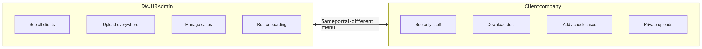
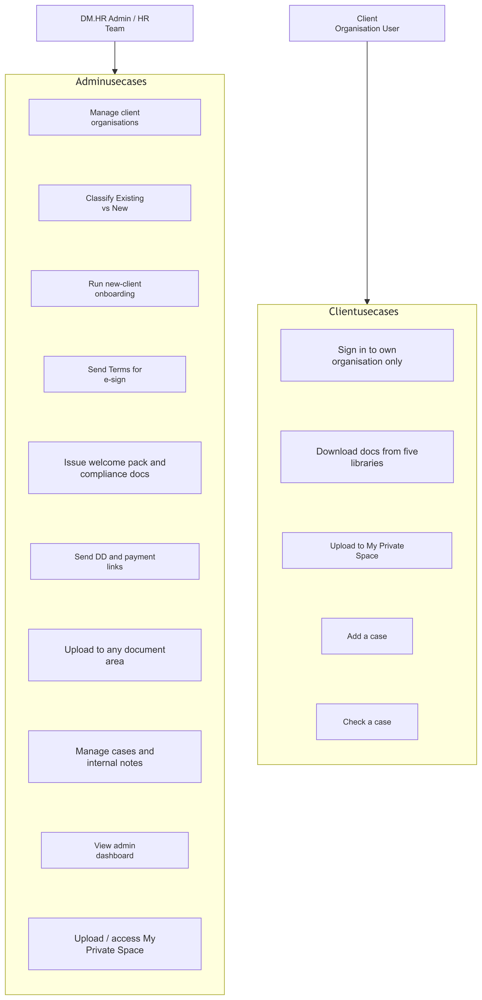
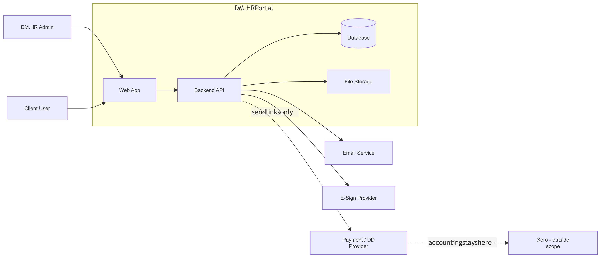
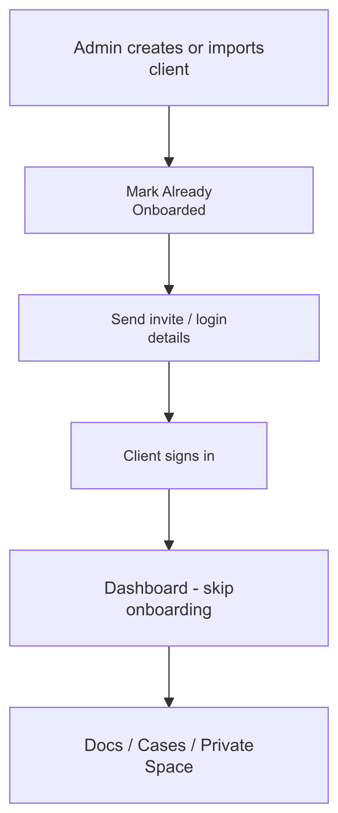
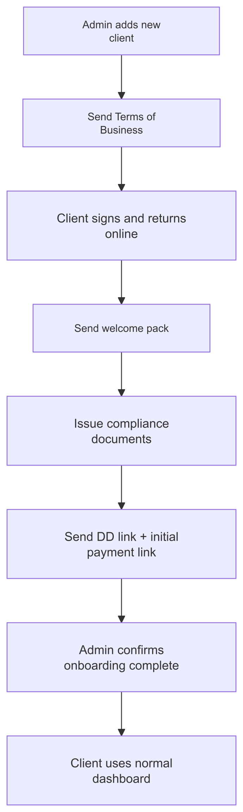
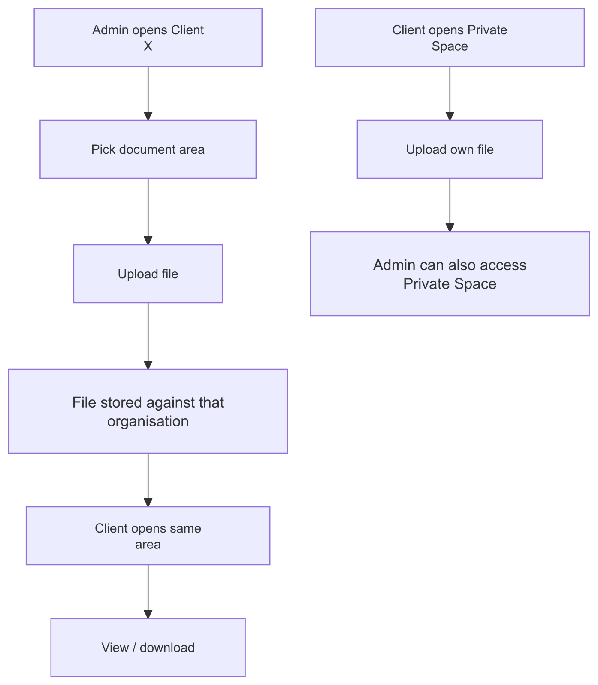
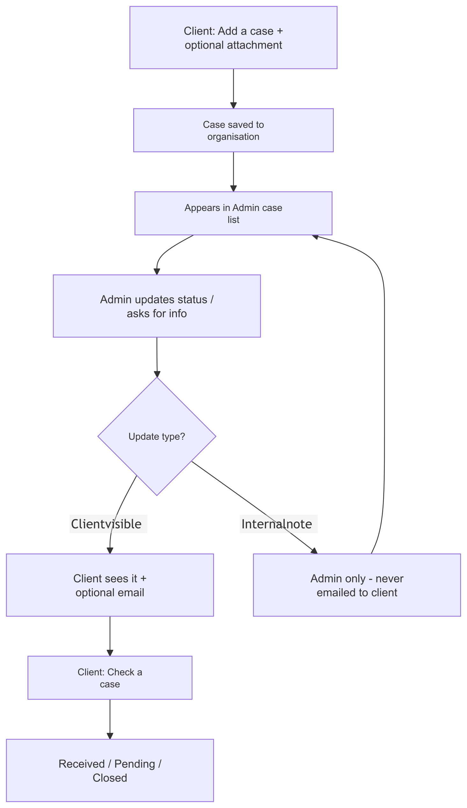
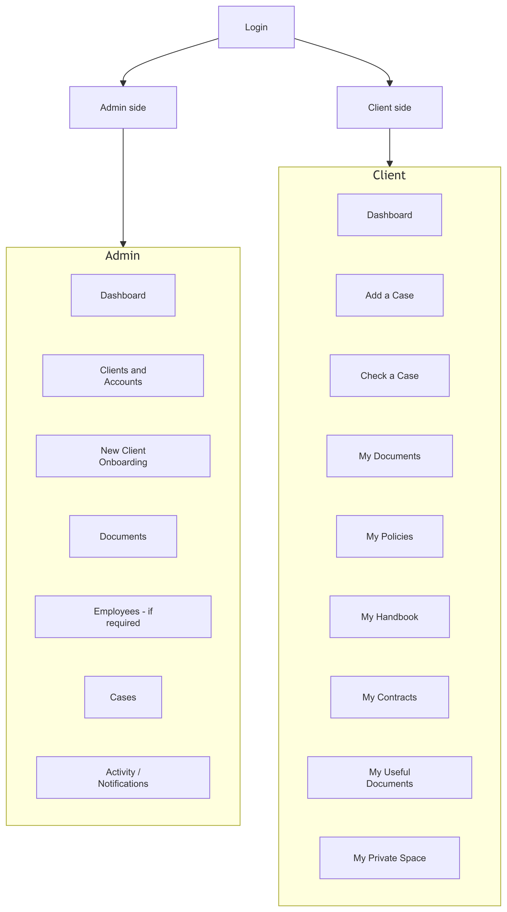
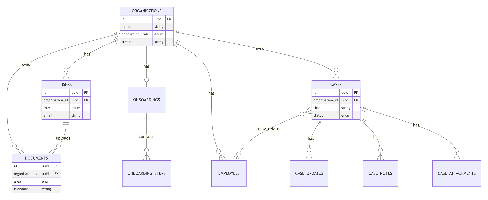

# DM.HR Group — Meeting Brief

**Client Portal & Case Management Platform**  
Sources: Scope of Work · David’s requirements message · HTML mockup (UI reference)

Use this one-pager to brief the project. Diagram **PNG images** live in `docs/diagrams/`.  
For a printable slideshow-style brief, open **`DMHR_Meeting_Brief.html`** in a browser → **Ctrl+P** → Save as PDF.

---

## 1. What is this portal?

DM.HR Group helps care companies with HR and employment issues.

Today that work is messy (email, Dropbox, paperwork).  
**This portal is one private website** where:

- **DM.HR** manages their clients
- **Each client company** only sees **their own** stuff
- Documents live in clear folders
- Problems become **cases** you can track
- **New** clients get guided online onboarding
- **Old** clients skip that and just use the portal

Think: **shared office online** between DM.HR and each company — not a public website.

---

## 2. Actors (who uses it)

| Actor | Who | Simple job |
|--------|-----|------------|
| **Admin / HR team** | People at DM.HR | Add clients, upload docs, run onboarding, handle cases |
| **Client user** | Person at the care company (manager / contact) | Login, get docs, open cases, upload private files |
| *(later)* **Employee** | Staff of the care company | **Not a main login in this foundation** — employees are mostly records, not portal users |

For v1 foundation: **2 real sides** — Admin and Client.

---

## 3. Two sides of the portal

Same system. Different menu after login.

---

## 4. What we are achieving

1. Each company has **its own locked room** (no peeking at other companies).
2. Docs are organised (not lost in email).
3. Cases have a clear thread (open → update → close).
4. New clients can onboard online; old ones jump straight in.
5. DM.HR looks professional and organised.

**One line:** Admin side = control room for all clients. Client side = that company’s private folder + cases. Goal = stop chasing HR work in email.

---

## 5. Actors & use case diagram

Actors connect to their use-case groups (Admin first, then Client). Boxes inside a group are capabilities, not ordered steps.

---

## 6. High-level system context

**Rule:** Portal stores payment/DD **links** + status. It does **not** process money or replace Xero.

---

## 7. User workflows / journeys

### A) Existing client (already with DM.HR)

1. Admin creates/imports company + login  
2. Marks them **Already onboarded**  
3. Client logs in → **dashboard** (no onboarding)  
4. Uses docs + cases + private space  

### B) New client

1. Admin adds company  
2. Send Terms → client **signs online**  
3. Send welcome pack  
4. Issue compliance docs  
5. Send Direct Debit + first payment **links**  
6. Admin marks onboarding **complete**  
7. Client uses normal portal (same as existing)

### C) Documents

1. Admin opens Client X → picks folder (Documents / Policies / Handbook / Contracts / Useful / Private)  
2. Uploads file  
3. Client logs in → opens that folder → **downloads**  
4. In **Private Space**, client can also **upload** their own files; admin can see those too  

### D) Case

1. Client clicks **Add a case** → fills form → maybe attaches file  
2. DM.HR sees it → replies / asks for more / updates status  
3. Client clicks **Check a case** → sees status + client-visible updates  
4. Email can notify when something important updates  
5. Internal HR notes stay **hidden** from the client  

---

## 8. Portal sides & navigation map (sitemap)

**Client document areas (6):** My Documents · My Policies · My Handbook · My Contracts · My Useful Documents · My Private Space

---

## 9. Data model (ER diagram)

**Key rules**

| Field | Values |
|-------|--------|
| `onboarding_status` | `existing_skip` · `in_progress` · `completed` |
| `documents.area` | `documents` · `policies` · `handbook` · `contracts` · `useful` · `private` |
| `users.role` | `admin` · `client` |
| Case updates | Client-visible updates vs internal notes (never emailed to client) |

Everything business-critical hangs off **`organisation_id`** (Company A never sees Company B).

---

## 10. Finished foundation product — what we will have

| You have | Meaning |
|----------|---------|
| Login | Admin and client accounts, secure |
| Clients list | Add companies; tag Existing vs New |
| Onboarding for new only | Steps + status; existing skip it |
| 6 document areas per client | Admin upload; client download; Private Space both ways |
| Cases | Create, track, update, close; emails for updates |
| Separation | Company A never sees Company B |
| Admin dashboard | Who needs attention (onboarding / cases) |

**Not in this foundation (unless agreed later):** full payments system, payroll, bulk Dropbox migration, employee self-login filling 30 forms.

---

## 11. Source alignment (quick)

| Source | Role |
|--------|------|
| SOW + David’s message | **Truth** for build |
| HTML mockup | UI feel (older: 3 doc folders; product uses **6**) |
| Early call understanding | Rough — right on clients/docs; overstated “30 employees fill forms” |

---

## Diagram index

| PNG | Diagram |
|-----|---------|
| `diagrams/00-two-sides.png` | Admin vs Client |
| `diagrams/01-use-cases.png` | Actors & use cases |
| `diagrams/02-system-context.png` | System context |
| `diagrams/03a-journey-existing-client.png` | Existing client journey |
| `diagrams/03b-journey-new-client.png` | New client onboarding |
| `diagrams/03c-journey-documents.png` | Documents flow |
| `diagrams/03d-journey-case.png` | Case flow |
| `diagrams/04-sitemap.png` | Navigation map |
| `diagrams/05-er-diagram.png` | Data model |

Also available as SVG (same names). Editable Mermaid sources: `diagrams/src/*.mmd`
